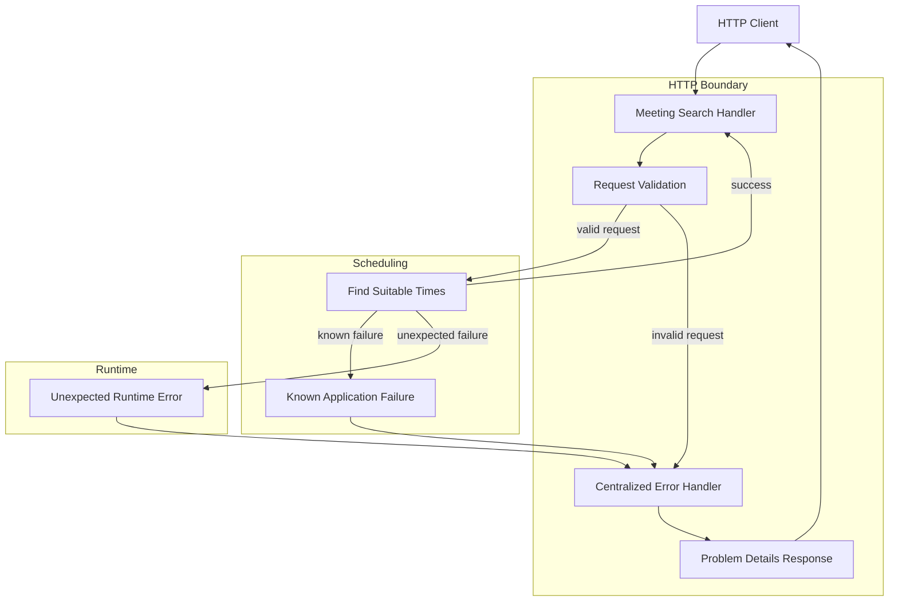

# Centralized HTTP Error Architecture

## Purpose

The `HTTP-boundary` converts request-time failures into predictable public responses. This keeps transport concerns out of scheduling logic, gives API clients stable error semantics, and prevents internal diagnostics or source-data details from becoming part of the API.

## Responsibilities

The HTTP-boundary owns request validation, HTTP-status selection, and construction of the public `Problem Details` response. Route handlers pass failures to the `centralized error handler` instead of defining independent error bodies.

`Application and domain layers` own business rules and availability logic. They may report a small set of meaningful known failures, but they do not choose HTTP status codes or construct HTTP responses. A valid scheduling request that finds no suitable intervals is successful and returns an empty result.

## Failure Boundaries

Request-time failures pass through the centralized handler. Invalid input and known application failures receive their defined client-error mappings. Unexpected failures receive a stable server-error response with no stack trace, parser detail, source data, or other internal information.

`Startup failures` are separate. Reference-data parsing, validation, or canonicalization failures occur before the service is usable, bypass request-time error mapping, and fail application startup.

## Public Error Contract

All request-time error categories exposed to clients use the API's stable Problem Details contract. The HTTP boundary alone owns that contract and its mapping from internal failure categories. Internal exception messages and implementation details are never used as public error content.

## Request-Time Flow

