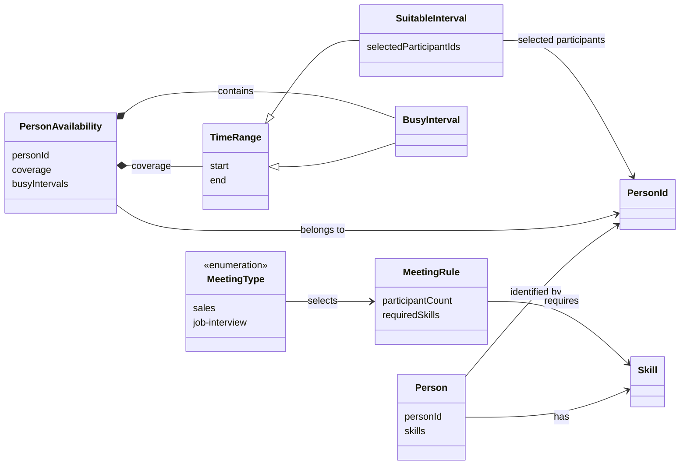

# Domain Model

## Purpose

The domain model defines the canonical, source-independent data used by scheduling.

## Core Concepts

| Concept | Meaning |
|---|---|
| `Person` | A participant identified by `PersonId` and associated with skills |
| `PersonId` | Canonical participant identity |
| `Skill` | A capability used to satisfy meeting requirements |
| `TimeRange` | A half-open interval `[start, end)` |
| `BusyInterval` | A `TimeRange` representing unavailable time |
| `PersonAvailability` | Authoritative availability data associated with a participant |
| `MeetingType` | Identifies the configured meeting rule |
| `MeetingRule` | Defines participant count and required skills |
| `SuitableInterval` | A suitable `TimeRange` associated with selected participants |

## Availability

`PersonAvailability` associates a `PersonId` with an authoritative `coverage` range and the `BusyInterval` values within that range.

Time outside `coverage` is not represented as known availability.

## Meeting Rules

Each `MeetingType` maps to a configured `MeetingRule`.

A `MeetingRule` defines the required participant count and required skills. A participant may satisfy more than one required skill.

Concrete meeting requirements are documented in `business-rules.md`.

## Scheduling Result

`SuitableInterval` represents a suitable continuous `TimeRange` together with the selected `PersonId` values.

A persisted `Meeting` or booking is not part of the domain model because the service only finds suitable times.

## Relationships

