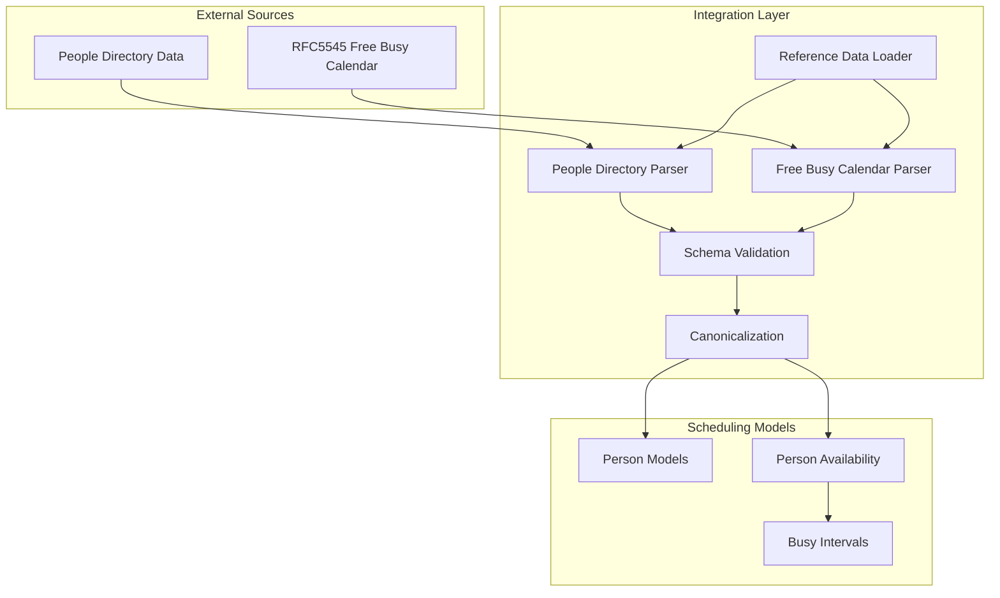

# Integration Architecture

## Purpose

The `integration layer` converts external reference data into `canonical scheduling models`.

External formats:
- people directory data
- RFC5545 free-busy calendar data

are not exposed to the `scheduling layer`.

## Responsibilities

### `Reference Data Loader`

Responsible for:
- loading reference files during startup
- coordinating parsers
- exposing validated data

### Parsers

Responsible for:
- reading external formats
- validating structure
- converting to internal representations

### `Canonicalization`

Responsible for:
- normalizing identity
- normalizing time ranges
- creating scheduling models

## Startup Behavior

Reference data loading is fail-fast.

If parsing or validation fails:
- application startup fails
- incomplete data is never exposed to scheduling

## Integration Flow

